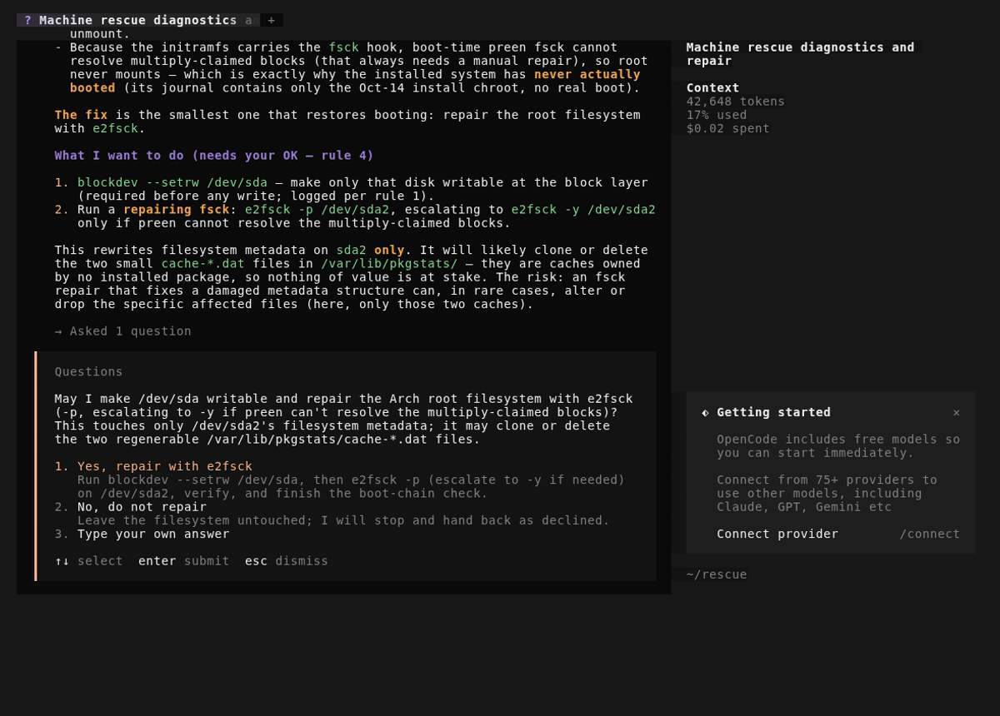

# system-rescuer

> Boot the broken machine from this USB stick, and an LLM repair agent starts
> by itself, diagnoses why the installed system no longer boots, and repairs
> it under data-safety guardrails while you watch.

Repairing a machine that no longer boots takes disk checks, filesystem and
EFI partition repairs, and a rebuild of the boot chain from a live medium.
This stick does that work with an agent: on boot it surveys the machine,
works out from evidence what is broken, explains what it will do, and repairs
it, asking for your OK before any step that could lose data.

**Start here: [docs/quickstart.md](docs/quickstart.md)**, from nothing to a
written stick, and what to do at the broken machine.

[](docs/demo.mp4)

*Open [the video](docs/demo.mp4) (two and a half minutes): the installer in a scratch VM, then a rescue of one of the [test bench](#the-test-bench)'s broken systems, the stick getting online by Wi-Fi from its menu; `tests/demo/record.sh` records it.*

## What it does

- Boots an x86_64 UEFI machine to an Arch Linux live system with networking
  (wired, Wi-Fi, a phone's USB tethering or a static address) and SSH.
- Starts a repair agent ([OpenCode](https://opencode.ai) with DeepSeek V4.1
  Flash by default, or any OpenAI-compatible model API) on the machine's own
  screen, with a repair brief and playbooks.
- Diagnoses and repairs a machine that no longer boots: a cut-off kernel
  update, a damaged or full EFI partition, a broken boot loader or initramfs,
  a dirty or damaged filesystem, a LUKS or btrfs root, a lost partition
  table, on systemd-boot or GRUB, on Arch, EndeavourOS, NixOS, Debian, Fedora
  and their relatives.
- On a machine with Linux and Windows, brings back the system that no longer
  appears at boot, without editing Windows' files.
- Says so and stops when a disk is failing: it hands the machine back with
  what it found rather than writing to that disk.
- Carries an offline package repository and a repair toolkit of 122
  commands (see [The toolkit](#the-toolkit)), so a repair that needs a
  package works without a mirror.
- Lets you follow and talk to the agent over SSH from another machine.

## What it does not do

- No Secure Boot (turn it off to start the stick), no legacy BIOS, no ARM or
  Apple Silicon.
- No data recovery: it repairs the boot of a system whose data is intact, and
  hands back a failing disk untouched. Copy your data off a failing disk with
  a tool made for that first.
- It is not offline: the model runs at the provider, so the machine needs
  internet.
- It does not run unattended: repairs that could lose data wait for your OK on
  the screen, and you should watch the rest.
- It makes no lasting configuration changes beyond the repair; it names them
  in its handback for you to make.

## Safety model

The agent runs as root on the live system, so the stick limits what it can
do, rather than relying on the model's judgement:

- **Read-only until diagnosed.** Every disk of the machine starts read-only at
  the block layer; the agent makes one writable only after logging its
  diagnosis, and only for that repair.
- **The owner's OK.** A repairing fsck, recreating a backed-up EFI partition,
  and any partition-table edit need your OK on the screen; a refusal is
  respected.
- **Hard limits.** No write to a failing disk, no mkfs except of an EFI
  partition it has backed up, no `btrfs check --repair`, and no edit of
  Windows' files or boot configuration.
- **A log.** Every step goes to `/root/rescue-log` with its reason, and a copy
  is left on the repaired disk when it can be.
- **A watchdog.** When a command hangs on a dying disk for ten minutes, the
  agent is restarted and told which command hung.

The project's test bench (below) checks these limits on every run: a run that
crosses one fails, however well the repair went.

## Privacy

- **What the provider receives.** The agent works by sending the model
  provider what it sees: the output of the commands it runs, excerpts of
  files and logs, and what you type. It reads only what the repair needs, but
  a repair needs a lot, so choose a provider whose data policy you accept for
  that machine. Disk and Wi-Fi passphrases are typed where the agent cannot
  see them, and its brief forbids printing private keys or secret files.
- **The key travels with the stick.** A stick that carries the API key gives
  it to whoever holds the stick; it is not encrypted. Use a key only for the
  stick, with a spending cap at the provider, and revoke it if the stick is
  lost. A stick can also carry no key and ask for it at boot.
- The key reaches the agent only through a local proxy on the stick; the
  agent itself never sees it.
- [docs/threat-model.md](docs/threat-model.md) lists each threat with its
  mitigation and the check that covers it; [SECURITY.md](SECURITY.md) says
  how to report a vulnerability.

## Requirements

- The broken machine: x86_64, UEFI, Secure Boot off, internet.
- A USB stick of 4 GB or more (the image and its package repository take
  about 2.8 GB).
- A Linux workstation (x86_64, with sudo and git) to write it. For a prebuilt image:
  `minisign` and `curl`. To build: Arch Linux with archiso, gitleaks and
  libisoburn, or Docker or rootful podman anywhere else, and about 16 GiB free.
- An API key for an OpenAI-compatible model, DeepSeek's by default. A repair
  on the test bench costs US$0.04 to 0.08 of DeepSeek V4.1 Flash credit; a
  long repair on a real machine costs somewhat more.

## Quickstart

Once the first release is out (none is yet, see below), the prebuilt image is
the short way:

```sh
git clone <this repository's URL> system-rescuer && cd system-rescuer
./install.sh --check --prebuilt     # what a prebuilt image needs on this host
./install.sh --prebuilt             # download, verify, ask for your key, write the stick
```

or build it yourself, with your SSH keys and machine profiles inside:

```sh
# first Docker (or rootful podman), or archiso on Arch: the quickstart's step B1
mkdir -p ~/.config/system-rescuer && cp -r examples/config/. ~/.config/system-rescuer/   # then edit it: the quickstart's step B2
./install.sh --check                # what a build needs on this host
./install.sh /dev/sdX               # build, write and verify the stick
```

`install.sh` writes only to a whole, removable USB disk that nothing has
mounted, after showing its model, serial and size and having you type its
name (`sdX`) back, and reads the image back against its sha256. Each step, the
options and what to do at the broken machine are in
[docs/quickstart.md](docs/quickstart.md).

Prebuilt images are signed with the project's minisign release key, which
`install.sh` pins and checks before writing; compare it with the key each
release's note prints:

```
untrusted comment: minisign public key 616329EA2650502A
RWQqUFAm6iljYbnTwJgFKElY6U5QwYX4X9rM/r6XoBkHbMxuxWCVVRSj
```

No image is published yet; until the first release, the quickstart shows how
to build and sign one yourself.

## How it works

- `build.sh` builds the image with archiso from `profile/` (derived from
  Arch's releng profile) and your configuration (`examples/config/` is the
  template): the SSH keys the stick accepts, the machine profiles, the
  provider, and the key or none. `install.sh` checks the host and runs it,
  natively or in a container, then writes the stick.
- At boot the stick brings up the network (with a menu on the screen when no
  address arrives), checks the API key with the provider, makes a read-only
  survey of the machine's disks, firmware and boot chain, and starts the
  agent in tmux on tty1 with the brief and playbooks in
  `profile/airootfs/root/rescue/`.
- The key stays in a root-only file on the live system that only the local
  proxy (`rescue-proxy`) reads, and the agent runs in a mount namespace
  without it.
- A prebuilt image carries no key: `install.sh --prebuilt` stores your key,
  and optionally an SSH key and another endpoint, in a small record past the
  signed image on the stick, so the image itself stays byte-identical to the
  release.

### Getting online

The agent's model runs online, so the stick needs a network before the agent
starts. A cable with DHCP needs nothing. When no address arrives, tty1 shows
a menu (`rescue-network`) before the agent starts:

1. **A phone's USB tethering**: plug the phone in and turn tethering on; it
   appears as a wired network card and is picked up by itself (an iPhone
   also asks you to tap Trust).
2. **A static address** on a cable, for a network without DHCP: the address,
   the gateway and the DNS server, typed at the menu.
3. **Wi-Fi**: the menu scans with iwd and lists the networks; you type the
   network's name, then its password at iwd's own prompt with the
   terminal's echo off, so the password never shows on the screen and never
   reaches a command line, a log or the agent.
4. **Keep waiting**, for a cable or the router.

The menu closes by itself as soon as a route appears, whichever way it came,
and the agent starts. Whatever the menu sets up (a static address, a Wi-Fi
profile) lives only in the live system and is gone at reboot; nothing is
written to the machine being repaired. Open a new window (Ctrl-b c) and run
`rescue-network` to bring the menu back later. The test bench joins Wi-Fi
this way on a simulated WPA2 network (scenario `c7-wifi`); the demo video
does too.

### The toolkit

Every command the agent may need is on the stick and works without a
network: 122 of them, listed for the agent in
[toolkit.md](profile/airootfs/root/rescue/toolkit.md), and
`tests/qemu-boot.sh` checks that each one resolves on the built image.

| Area | Tools |
|---|---|
| Disk health and imaging | `smartctl`, `nvme`, `hdparm`, `badblocks` (read-only), `ddrescue`, `partclone`, `fsarchiver`, `ntfsclone`, the Sleuth Kit, `foremost`, `fwupdmgr` (to read) |
| Partition tables | `sgdisk`, `gdisk`, `sfdisk`, `parted`, `testdisk`, `gpart` |
| Filesystems | ext2/3/4 (`e2fsck`, `debugfs`, `tune2fs`), btrfs, XFS, F2FS, FAT, exFAT, NTFS, bcachefs |
| LVM, RAID, encryption | `pvs`, `vgs`, `lvs`, `thin_check`, `mdadm`, `cryptsetup` (LUKS, and BitLocker read-only), `dmsetup` |
| Boot | `bootctl`, `ukify`, GRUB, rEFInd, `efibootmgr`, `efivar`, `mokutil`, `sbctl`, `sbsign`, `mkinitcpio`, `dracut`, `arch-chroot` |
| Windows | `ntfs-3g`, `ntfsfix`, `hivexsh`, `chntpw`, `wimlib-imagex` |
| Network | `rescue-network`, `iwctl`, `wpa_supplicant`, `dhcpcd`, `mmcli` (modems), `pppd`, `usbmuxd` (iPhone tethering) |
| Hardware and processes | `dmesg`, `journalctl`, `lspci`, `lsusb`, `dmidecode`, `strace`, `htop` |

The image also carries Linux's firmware packages, so most Wi-Fi cards and
storage controllers work. The offline package repository (an Arch
repository on the stick, `rescue-repo`) lets the agent reinstall a package
into the machine's own system, through its own package manager in a chroot,
without a mirror. The brief decides which of these the agent may run, and
when: a tool on the list grants nothing (see [Safety model](#safety-model)).

### Machine profiles

Knowledge about one of your machines (its disks and which not to touch, how
its boot chain is rebuilt, past incidents) goes in a profile in the
configuration's `machines/`, matched at boot by filesystem UUID; see
[machines/README.md](profile/airootfs/root/rescue/machines/README.md). Never
put secrets there. A prebuilt image has none; build one to add them.

## The test bench

`tests/` holds a bench of real installed systems broken on purpose: Arch,
EndeavourOS (LUKS and btrfs) and NixOS on systemd-boot, Debian and Fedora on
GRUB, and Linux beside a Windows 11 evaluation install (with BitLocker, or
hibernated). Each scenario breaks a copy of a system, boots the stick beside
it under qemu (OVMF, user-mode networking), answers the agent's questions as
a stand-in owner, and judges the run: the disk boots on its own, the owner's
files are unchanged, the log names the planted cause, no guardrail was
crossed and no secret leaked.

```sh
sudo tests/base-image.sh debian-grub --boot                   # build or reuse a cached base
sudo tests/scenario.sh a6-empty-grub-cfg --base debian-grub   # break a copy, rescue it, judge it
sudo tests/scenario-matrix.sh --dry-run                       # project the whole matrix's API cost
```

A run takes 3 to 5 minutes and US$0.04 to 0.08 of credit. The full matrix,
45 scenario cells in 105 runs, passed on one image: every guardrail held in
every run, and every repair passed in at least two of three runs.
[CONTRIBUTING.md](CONTRIBUTING.md) says which checks a change needs.

## Limitations

- The agent is a language model: it can misread evidence or choose a poor
  repair. The guardrails limit what a mistake can destroy, not whether it
  happens, and a repair passing two of three bench runs means it sometimes
  takes a second run.
- A machine unlike the bench's systems (another boot loader, an unusual
  storage stack, hardware RAID) may defeat it; it then hands back what it
  found.
- A key stored on the stick is not encrypted.
- Prebuilt images are x86_64 only, and none is published yet.

## Status

Working. Its first real rescue brought back a NixOS home server whose
generation switch had been cut off (a 0-byte kernel, no initrd), on
2026-10-13; since then the bench above has driven its repairs and
guardrails. The installer, the key-less prebuilt image and its signature
check are done; the first public release is the maintainer's decision.

## Licence

Copyright (C) 2026 Mikael Moghadam (Binary Business).

GPL-3.0-or-later ([LICENSE](LICENSE)), as archiso's releng profile it derives
from. What the tree and the image carry from others is in
[THIRD-PARTY-NOTICES.md](THIRD-PARTY-NOTICES.md).
